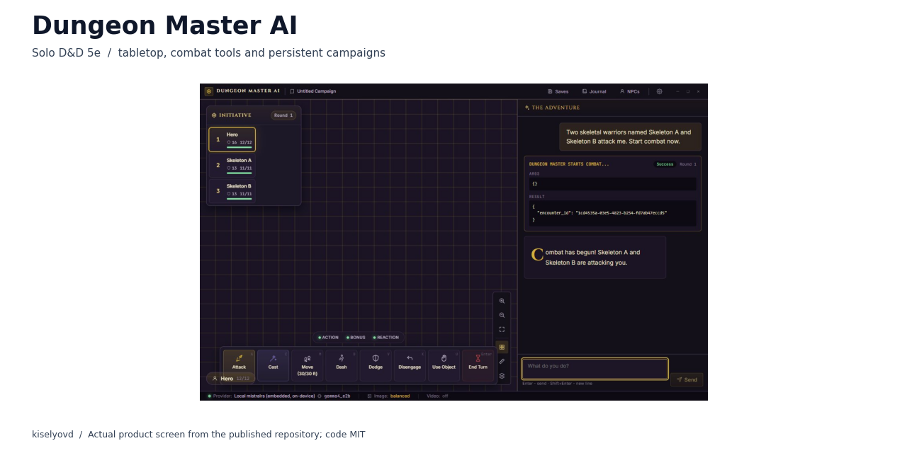

# Dungeon Master AI

An AI Dungeon Master for solo D&D 5e, with a virtual tabletop and campaign saves. Built with Rust, Tauri, and React.

[](LICENSE) [](#try-it)

Create a character, describe an action, and let the DM narrate the scene and invoke game tools. The backend resolves initiative, turns, damage, conditions, and spells; the campaign state persists in SQLite.

[](https://kiselyovd.github.io/showcase/dungeon-master-ai/)

**[Explore the product tour](https://kiselyovd.github.io/showcase/dungeon-master-ai/)** — character creation, combat, and the platform-specific path to the published release.

## Try it

Download an installer from [GitHub Releases](https://github.com/kiselyovd/dungeon-master-ai/releases/latest). The latest published milestone is **v0.12.0-real-engine**; its installer filenames retain the package version **0.1.0**.

| Platform | Published assets in that release |
|---|---|
| Windows x64 | `.exe`, `.msi` |
| macOS Apple silicon | `.dmg` |
| Linux x64 | `.AppImage`, `.deb` |

Code signing and macOS notarization are optional in the release workflow. Updater signatures are separate; see the [release guide](docs/RELEASE.md) for the distribution setup.

Choose a provider in onboarding, create or select a character, play a scene, then save and reopen the campaign. Cloud mode uses an OpenAI-compatible endpoint. Local mode requires compatible model sidecars and model downloads; see the [developer guide](docs/development.md#dev-setup).

## What it includes

- A DM agent that combines narration with game tools and SRD rules retrieval.
- A server-authoritative combat engine and a tabletop with tokens, zoom, and pan.
- Character creation, NPC memory, a journal, and campaign saves.
- Scene illustrations, maps, and video generation through configured providers.
- English and Russian interfaces.

## Run from source

Install Rust stable, Bun 1.3+, and the [Tauri prerequisites](https://tauri.app/start/prerequisites/) for your OS, then:

```bash
git clone https://github.com/kiselyovd/dungeon-master-ai.git
cd dungeon-master-ai
bun install
bun run tauri dev
```

This starts the desktop app and Rust backend for cloud mode. Configure your endpoint and key in onboarding. Local LLM and image sidecars have additional [setup steps](docs/development.md#dev-setup).

## Status and limitations

The project is at a pre-1.0 milestone; public APIs and save schemas may change. Local runtime support depends on model format, hardware, and platform. The published notes record a Windows GGUF loading issue; the ISQ path is the documented alternative. See [known limitations](docs/development.md#known-limitations) and the [changelog](CHANGELOG.md) before choosing a runtime.

## Documentation

| Guide | Covers |
|---|---|
| [Developer guide](docs/development.md) | Architecture, providers, local setup, tests, and backlog |
| [Release pipeline](docs/RELEASE.md) | Bundles, updater signatures, and platform signing |
| [Release checklist](docs/RELEASE_CHECKLIST.md) | Manual acceptance scenarios |
| [Changelog](CHANGELOG.md) | Changes by milestone |

## License

[MIT](LICENSE) for this repository's code. External models and D&D SRD content have their own terms; consult the relevant source and attribution files.
