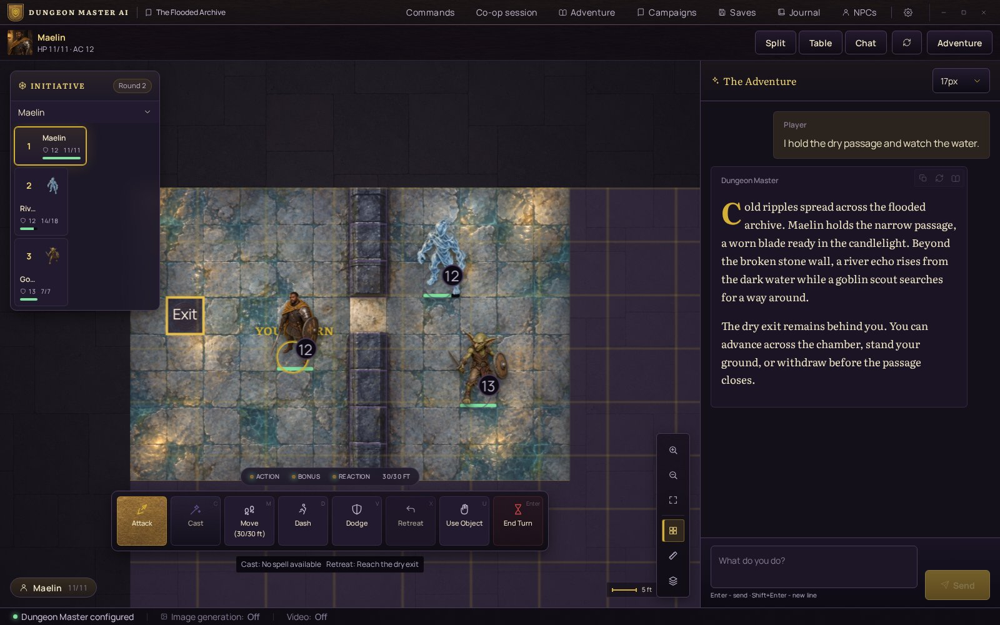
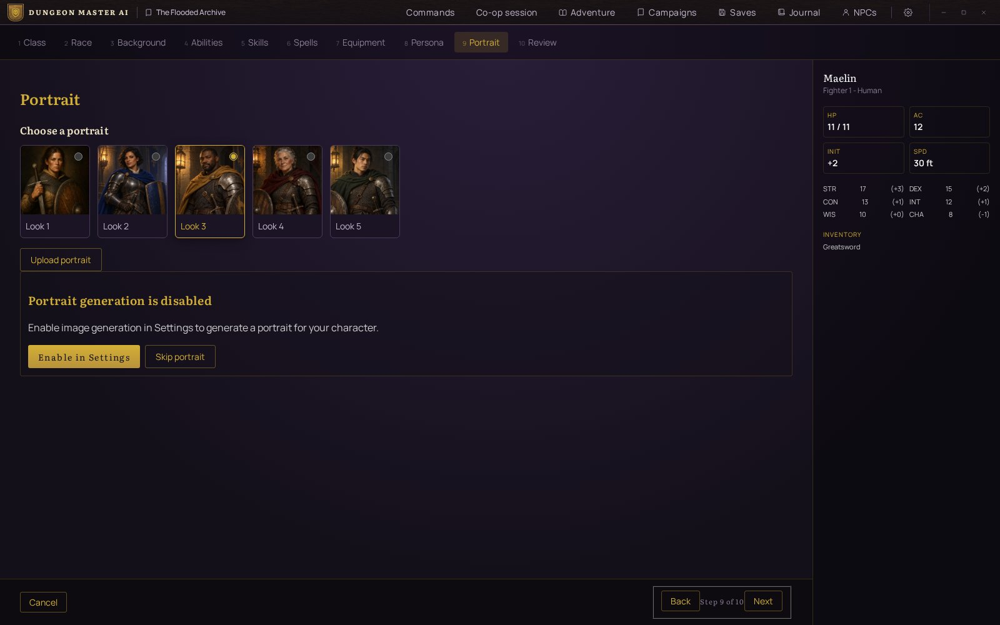

# Dungeon Master AI

 

> A desktop Dungeon Master for solo D&D 5e, with experimental cooperative play.

Create a hero, explore a prepared adventure or your own opening scene, and play through chat and a virtual tabletop. The game backend owns rules, campaign state and confirmed outcomes; the AI narrates and requests game actions.

  
  

Production browser previews with controlled test data: combat and the hero portrait gallery. These images do not establish native or real-model acceptance.

**Experimental, before 1.0.** Campaign recovery, party play and desktop workflows are implemented, with acceptance limits recorded in the [documentation index](docs/README.md). A successful build does not establish complete real-model gameplay or physical two-device LAN/VPN support.

## Download and start

1. Open [GitHub Releases](https://github.com/kiselyovd/dungeon-master-ai/releases) and choose Windows x64, macOS Apple Silicon or Linux x64. Read the release's startup and signing notes.
2. Follow [Getting started](docs/GETTING_STARTED.md), including its vault/startup requirements. Keep existing application data and credentials when upgrading.
3. Choose **Start adventure**, select **Bell Beneath the Water** or a custom opening, prepare your hero and enter the first scene.
4. Configure **Settings > Chat > Model server** with an OpenAI-compatible provider, its API base, your key and an available model ID. Send an action and check the confirmed result.

The standard release is the **cloud flavor**: the desktop app and `dmai-server`, without embedded model/media executables or model weights. An existing local OpenAI-compatible server also works through Model server. Embedded GPU/model support requires separate runtimes and hardware checks.

### Example: RouterAI or OpenRouter

| Service | API base |
| --- | --- |
| RouterAI | `https://routerai.ru/api/v1` |
| OpenRouter | `https://openrouter.ai/api/v1` |

Enter the API base without `/chat/completions`, keep the key in Settings, and select an exact model ID from that provider's current catalog. Model availability, tool support and pricing depend on the provider and account. See [Configuration](docs/CONFIGURATION.md) for discovery, local servers and optional media.

## What you can do

- **Play and continue a campaign.** Persistent heroes, scenes, journals, NPC memories, saves and durable request recovery keep the campaign tied to its own state.
- **Use supported D&D mechanics.** Server-confirmed combat covers initiative, attacks, supported spells, equipment, conditions, rest and recovery. The client renders newer authoritative revisions.
- **Explore a prepared adventure.** Bell Beneath the Water includes discoveries, rescue decisions, authored consequences and distinct outcomes.
- **Host an experimental co-op room.** Guests review an invitation, join deliberately and use their own accepted hero. The host owns campaign storage and the shared model; guests do not need the host's API key.
- **Arrange the desktop.** Split/Table/Chat views, a command palette, saved workspace, scoped hero/journal windows, native invitations, opt-in notifications and portable campaign files support longer sessions.
- **Choose presentation and language.** English and Russian interfaces, bundled fantasy artwork, portraits, miniatures and scene presentation work alongside optional generated media.

For example, continue a saved Bell campaign, inspect the journal, send a short action, then use the confirmed encounter controls on the table. After an interrupted reply, recover its existing operation instead of sending the same action as a new request. [Campaign state](docs/CAMPAIGN_STATE.md) and [AI turn recovery](docs/AI_TURN_RECOVERY.md) explain the boundary.

## Cooperative play

The organizer starts **Co-op session**, creates a room and shares an invitation containing a reachable LAN/VPN address. Guests choose **Join game**, check the destination and explicitly join. `localhost` is not an address for a second computer.

There is no public matchmaking or automatic Internet relay. Same-machine two-client checks and actual two-device acceptance are separate; see [Room invitations](docs/ROOM_INVITATIONS.md) and [Co-op acceptance](docs/COOP_ACCEPTANCE.md). Local solo save controls are unavailable while a room is active.

## Stack

- Tauri 2 owns the native windows and backend/optional runtime processes.
- React 19, TypeScript, Vite, Zustand and PixiJS provide the presentation layer.
- Rust separates deterministic rules, application use cases, HTTP/SQLite/LLM/media/secrets adapters and backend composition.
- Bun, Biome, Vitest, Playwright, Cargo and Python 3.12 offline tests provide the checks. Heavy image/video inference stays in the optional Python sidecar.

See [Architecture](ARCHITECTURE.md) for the repository map and dependency directions. Standard release targets are Windows x64, macOS arm64 and Linux x64; Intel macOS is outside the current matrix.

## Develop and verify

[Contributing](CONTRIBUTING.md) covers container-managed dependencies, native platform requirements and development commands. Do not install or overwrite a host toolchain as an implicit setup step. Use a reviewed native exception when a container cannot provide the required OS/GPU/WebView.

The consolidated gate is `bun run gates`; `bun run gates:fast` is its smaller iteration subset. Production-build browser checks, native WebView checks, offline Python checks and real-model/GPU acceptance remain distinct. The [release checklist](docs/RELEASE_CHECKLIST.md) records those layers.

## Documentation

| Guide | Contents |
| --- | --- |
| [Getting started](docs/GETTING_STARTED.md) | Install, first adventure, continue and join |
| [Configuration](docs/CONFIGURATION.md) | Providers, local runtimes, media and credentials |
| [Documentation index](docs/README.md) | Campaign, combat, room and desktop topic guides |
| [Architecture](ARCHITECTURE.md) | Modules, process ownership and stable contracts |
| [Contributing](CONTRIBUTING.md) | Development, tests and review conventions |
| [Release guide](docs/RELEASE.md) | Platforms, signatures and publication |
| [Release checklist](docs/RELEASE_CHECKLIST.md) | Required evidence and manual acceptance limits |
| [Python sidecar](sidecar/README.md) | Optional image/video runtime and packaging |

Browse the [Wiki](https://github.com/kiselyovd/dungeon-master-ai/wiki) for entry points. [CHANGELOG.md](CHANGELOG.md) records versions; [Security](SECURITY.md) covers credentials and private data. Historical QA reports identify the revision and environment they tested.

## Known limits

- This is not a complete implementation of every D&D 5e rule or class feature.
- Physical two-device LAN/VPN and complete long-form real-model acceptance remain separate open checks. Repeated physical DPI checks were waived for this development cycle.
- Cloud packaging does not prove embedded model loading, GPU contention, media generation or upstream model behavior. Some Windows GGUF paths have recorded upstream failures; consult the runtime-specific evidence.
- Without the optional trusted platform certificates, Windows/macOS may report an unidentified publisher. Updater signatures authenticate update packages and do not replace OS code signing.
- Back up campaigns through the supported controls. Do not share provider vaults, live databases or private invitation material in issues or screenshots.

## License

MIT. See [LICENSE](LICENSE).
